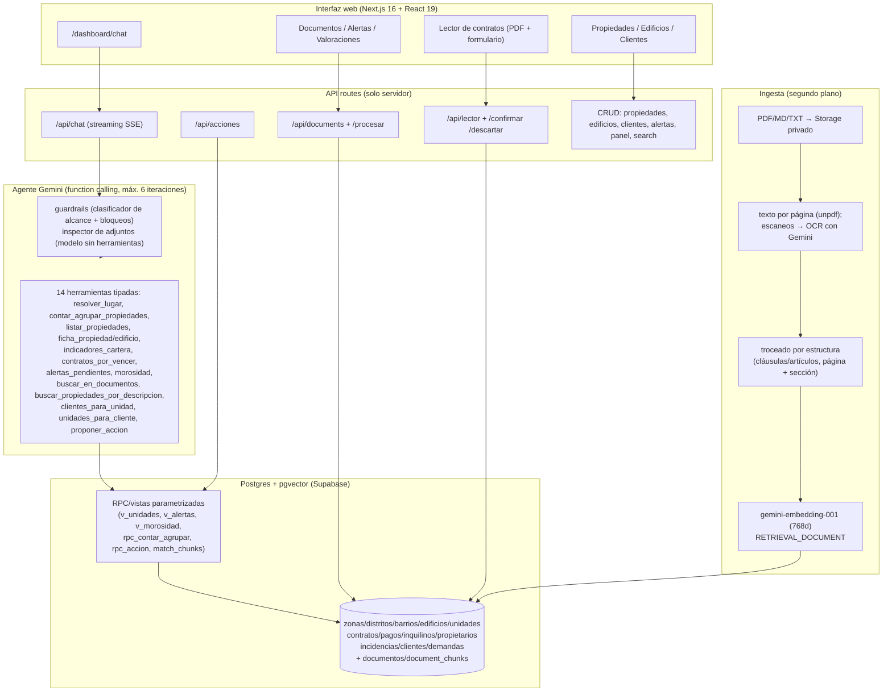

# Atlas RAG — asistente de gestión inmobiliaria (Next.js + Supabase pgvector + Gemini)

> English version: [README.md](README.md)

Atlas es un asistente de demostración para agencias inmobiliarias de la Comunidad de Madrid.
El chat **cuenta y filtra con SQL** y **lee documentos con búsqueda semántica**; un
**lector de contratos** extrae los datos de un PDF para que una persona los verifique antes de guardarlos.

Todos los datos de demostración son **sintéticos** (faker determinista con semilla fija,
emails `@example.com`, DNI/NIE/CIF y sociedades inventados). No hay inquilinos,
propietarios, credenciales ni datos reales en este repo.

## Problema

El RAG genérico no sabe contar ("¿cuántos pisos libres hay en el sur?") y el text-to-SQL
deja que el modelo escriba SQL arbitrario. Atlas lo divide así:

- **Preguntas estructuradas → function calling.** Gemini elige una herramienta tipada
  (validada con zod); el servidor ejecuta una RPC/vista parametrizada de Supabase. El LLM
  nunca escribe SQL. Regla del sistema: *"los números solo pueden salir de las herramientas; nunca estimes."*
- **Preguntas de documentos → búsqueda híbrida.** pgvector (coseno) + full-text en español,
  combinados con RRF, filtrados por unidad/edificio/tipo, con citas estilo `[F1]`.
- **Escrituras → confirmación humana.** El asistente propone (abrir incidencia, dar de alta
  un cliente, resolver/posponer alerta, cambiar estado de unidad); nada se ejecuta hasta que
  una persona pulsa Confirmar. Todo queda en auditoría.

## Arquitectura



Flujos clave:

1. **Chat:** la UI consume SSE → `/api/chat` aplica guardrails → bucle del agente
   (modelo → llamada a herramienta → el servidor ejecuta la RPC → resultado al modelo) →
   texto final con citas y transparencia de herramientas. Historial (14 mensajes) para
   seguimientos ("¿y en el sur?").
2. **Adjuntos:** imágenes/PDF (máx. 3 archivos, 3 MB) validados (firma real, sin contenido
   activo en PDF), capa de texto analizada, inspección con un **modelo sin herramientas**
   que busca inyecciones (incluido texto diminuto/camuflado); mínimo privilegio (sin
   escrituras con archivos en contexto); salida saneada + CSP.
3. **Lector de contratos:** Gemini lee el PDF con JSON Schema generado desde
   `catalogo_campos` (catálogo cerrado — solo devuelve campos conocidos), cada campo con
   valor + confianza + procedencia (página + cita literal). El borrador queda en
   `extracciones`; Confirmar escribe en transacción vía RPC + fila de auditoría.
4. **Seed (sintético):** `scripts/seed/*.ts` (faker, semilla fija `20260930`) →
   ~1.300 unidades, ~1.200 inquilinos, ~17.000 pagos, ~1.500 incidencias + ~79 PDFs
   sintéticos (contratos, normas, actas, un escaneado para OCR).

## Decisiones / trade-offs

| Decisión | Elección | Contrapartida |
|---|---|---|
| Sin LangChain/LlamaIndex | Bucle propio (~6 iteraciones) | Más control, menos magia; reintentos/streaming propios |
| El LLM nunca escribe SQL | Herramientas validadas → solo RPC/vistas | Sin SQL ad-hoc real; más seguro y auditable |
| Solo Gemini (sin Anthropic) | `gemini-flash-lite-latest` + lista de reserva | La capa gratuita tiene poca cuota → reintentos + fallback + backoff en 429 |
| Embeddings fijados | `gemini-embedding-001`, 768 dims, `embedding_model` por fragmento | Cambiar de modelo = reindexar todo |
| HNSW + filtros estrictos | HNSW de pgvector, `match_chunks` con herencia (unidad + contrato + edificio + general) | Puede devolver de menos; mitigado con scan iterativo / búsqueda exacta |
| Auth: contraseñas compartidas | `APP_REQUIRE_LOGIN` + gestor/admin (sin Supabase Auth por propietario todavía) | Simple para demo; no es multitenant — ver Seguridad |
| Alertas calculadas en vivo | Vista `v_alertas`, sin cron | Siempre frescas; sin notificaciones push |
| Next.js 16 + React Compiler | Turbopack, chat memoizado | Rápido; hay que leer `node_modules/next/dist/docs/` antes de escribir rutas (ver AGENTS.md) |
| Formato español | `1.250,00 €`, `dd/mm/aaaa`, "3º B" | La demo solo está en es-ES |

## Seguridad

- **Abierta por defecto.** Sin `APP_REQUIRE_LOGIN=true` (+ `APP_PASSWORD`,
  `APP_ADMIN_PASSWORD`) cualquiera con la URL puede ver *y borrar* los datos de demo.
  Activa el login en cualquier despliegue compartido.
- **`service_role` solo en servidor.** RLS activado sin políticas públicas; las RPC no son
  ejecutables con la clave anon. La anon (opcional) solo sirve para subidas directas a
  Storage de >4 MB.
- **Threat model de adjuntos** (probado con `pnpm adjuntos:test`):
  1. *Contenido malicioso* (inyección en imagen/PDF, texto oculto o diminuto) →
     bloqueado antes de llegar al agente; intento registrado en Valoraciones; aviso al usuario.
  2. *Exfiltración vía markdown* (imagen remota ``,
     enlaces peligrosos) → salida saneada + CSP `img-src 'self' data: blob:` como red.
  3. *Escalada de privilegios* (el archivo engaña al modelo para escribir) → herramientas de
     escritura retiradas del esquema con archivos presentes; el servidor lo rechaza igual.
  4. *Contenido manipulado/activo* (firma falsa, JS/formularios en PDF) → rechazado al subir.
- **Protección de la BD en el lector:** borrador aislado (`extracciones`), catálogo cerrado
  (+ `atributos_*` tipados), campos nuevos con aprobación de admin (`solicitudes_campo`),
  doble validación (zod + CHECK/FK en Postgres), resolución de entidades (vincular por DNI,
  nunca duplicar), diff con la fila existente, auditoría completa.
- **Aviso PII:** el seed es ficticio, pero la capa gratuita de Gemini puede usar los datos
  para entrenar. Antes de datos reales: plan de pago (sin entrenamiento) + auth por usuario
  con RLS + enmascarado de DNI/IBAN.
- Las respuestas legales (LAU / Ley 12/2023) son **orientativas, no asesoramiento jurídico**.

## Costes (Gemini)

- Modelo de chat `gemini-flash-lite-latest`; configurable con `GEMINI_CHAT_MODEL`,
  docs/OCR con `GEMINI_DOCS_MODEL`, reserva ante cuota con `GEMINI_FALLBACK_MODELS`.
- Cada pregunta cuesta ~2–4 llamadas (más 1 de inspección si hay adjuntos).
- La capa gratuita tiene topes diarios muy bajos; ante 429/cuota el sistema reintenta con
  backoff y pasa a la lista de reserva. Para uso real, activa la facturación.
- Mide con `pnpm coste:check` (Supabase real): tokens por pregunta + calidad vectorial.

## Correr sin servicios externos (PGlite)

Migraciones, seed y baterías offline corren en Postgres en memoria (PGlite). Sin `.env`, sin red:

```bash
pnpm install
pnpm db:check        # aplica las migraciones en PGlite
pnpm seed:test       # carga el seed sintético + coherencia
pnpm acciones:test   # batería de rpc_accion (local)
pnpm adjuntos:test   # batería de seguridad determinista (Gemini real omitido)
```

Para la app completa necesitas Supabase + Gemini (ver `.env.example`):

```bash
cp .env.example .env   # rellena las claves
pnpm db:bundle         # → pega supabase/all-migrations.sql en el SQL Editor de Supabase
pnpm seed              # ~1.300 propiedades, ~1.200 inquilinos, ~16.000 pagos
pnpm seed:embeddings   # embeddings de descripciones y notas de clientes
pnpm seed:docs         # 79 documentos + 3 PDFs de prueba para el lector
pnpm dev
```

Los PDF de prueba quedan en `seed-output/pdfs/prueba-lector/` (ignorado por git): inquilino
nuevo, inquilino existente y escaneado.

## Scripts de test

| Script | ¿Necesita secretos? | Qué hace |
|---|---|---|
| `pnpm lint` | No | eslint (Next core-web-vitals + TS) |
| `pnpm exec tsc --noEmit` | No | typecheck |
| `pnpm db:check` | No | las migraciones aplican en limpio en PGlite |
| `pnpm seed:test` | No | seed + coherencia (ocupación ≈ 88–90 %, 0 huérfanos) |
| `pnpm acciones:test` | No | `rpc_accion` (vista previa/ejecución/validación/auditoría) en PGlite |
| `pnpm adjuntos:test` | No (determinista) | batería de inyección/seguridad; `-- --live` añade Gemini real |
| `pnpm agent:test [-- --docs "…"]` | **Sí** (`GEMINI_API_KEY`) | agente completo sobre el seed en PGlite; `--docs` indexa docs antes |
| `pnpm lector:test` | **Sí** | extracción + confirmación de contratos de extremo a extremo |
| `pnpm guardrails:test` | **Sí** | batería de ataques y mensajes legítimos |
| `pnpm seed / seed:embeddings / seed:docs` | **Sí** (Supabase + Gemini) | carga el backend real |
| `pnpm prod:check`, `pnpm coste:check` | **Sí** | e2e + coste/calidad contra Supabase real |
| `pnpm db:migrate` / `db:bundle` | `db:migrate` sí (`SUPABASE_DB_URL`) | aplica migraciones / genera SQL para el editor |

CI ejecuta las filas sin secretos más `next build`; los scripts `--live`/con secretos quedan fuera.

## Demo

- Demo en producción (Vercel): **https://rag-simple.vercel.app** → redirige a `/dashboard`.
  Verificada el 2026-10-11 con una única petición `HEAD` (Next.js en Vercel, sin secretos en
  cabeceras). La app está abierta por defecto (sin login) y muestra **solo datos sintéticos**.
- Capturas de la UI: **pendientes** (no tomadas durante la publicación saneada; ver `docs/`
  y las rutas del dashboard: chat, propiedades, edificios, clientes, documentos, lector,
  alertas, valoraciones).

## Notas del repo

- Historial público de 1 commit (`atlas-rag`); el historial privado original no se publica.
- Prototipo Python antiguo (`rag.py`, `ingest.py`, `ask.py`, `schema.sql`) conservado como
  referencia; el stack activo es TypeScript (`scripts/`) + `supabase/migrations/`.
- `PLAN.md` / `PLAN-propiedades.md` son los planes de construcción originales.
- Licencia: MIT — ver [LICENSE](LICENSE).
