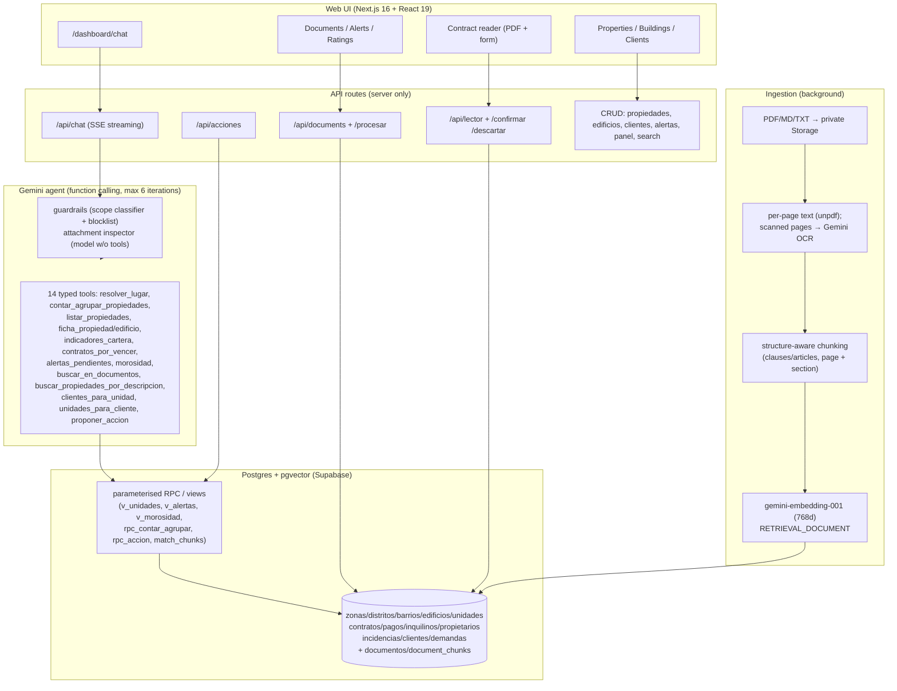

# Atlas RAG — property-management assistant (Next.js + Supabase pgvector + Gemini)

> Spanish version: [README.es.md](README.es.md)

Atlas ("Atlas RAG") is a demo assistant for property managers in the Madrid region.
The chat **counts and filters with SQL** and **reads documents with semantic search**; a
**contract reader** extracts data from a PDF so a human can verify it before saving.

All demo data is **synthetic** (deterministic faker seed, `@example.com` emails,
invented DNI/NIE/CIF and companies). There are no real tenants, owners, or credentials
anywhere in this repo.

## Problem

Generic RAG cannot count ("how many vacant flats in the south?") and raw
text-to-SQL lets the model write arbitrary SQL. Atlas splits the problem:

- **Structured questions → function calling.** Gemini picks a typed tool
  (zod-validated); the server runs a parameterised Supabase RPC/view. The LLM
  never writes SQL. System rule: *"numbers may only come from tools; never estimate."*
- **Document questions → hybrid search.** pgvector cosine + Spanish full-text,
  combined with RRF, filtered by unit/building/type, with `[F1]`-style citations.
- **Writes → human confirmation.** The assistant proposes (open incident, register
  client, resolve/postpone alert, change unit status); nothing executes until a
  person clicks Confirm. Everything lands in an audit table.

## Architecture



Key flows:

1. **Chat:** UI streams SSE → `/api/chat` runs guardrails → agent loop
   (model → tool call → server executes RPC → result back) → final text with
   citations + tool transparency. History (14 msgs) enables follow-ups ("and in the south?").
2. **Attachments:** images/PDFs (≤3 files, ≤3 MB) are validated (real magic bytes,
   no active PDF content), text-layer analysed, inspected by a **tool-less model call**
   that hunts for prompt-injection (including tiny/camouflaged text); least privilege
   (no write actions while files are in context); sanitised output + CSP.
3. **Contract reader:** Gemini reads the PDF with JSON Schema generated from
   `catalogo_campos` (closed catalogue — it can only return known fields), each field
   with value + confidence + provenance (page + literal quote). Draft stays in
   `extracciones`; Confirm writes transactionally via RPC + audit row.
4. **Seed (synthetic):** `scripts/seed/*.ts` (faker, fixed seed `20260930`) →
   ~1,300 units, ~1,200 tenants, ~17,000 payments, ~1,500 incidents + ~79 synthetic
   PDFs (contracts, community rules, minutes, one scanned PDF for OCR).

## Decisions / trade-offs

| Decision | Choice | Trade-off |
|---|---|---|
| No LangChain/LlamaIndex | Hand-rolled agent loop (~6 iterations) | More control, less magic; we own retries/streaming |
| LLM never writes SQL | zod-validated tools → RPC/views only | Cannot answer truly ad-hoc SQL; safer + auditable |
| Gemini only (no Anthropic) | `gemini-flash-lite-latest`, fallback list | Free tier quotas are tiny → retries + model fallback + 429 backoff |
| Embeddings pinned | `gemini-embedding-001`, 768 dims, `embedding_model` stored per chunk | Changing model = reindex everything |
| HNSW + strict filters | pgvector HNSW, `match_chunks` with inheritance (unit + contract + building + general) | May under-return; mitigated with iterative scan / exact search fallback |
| Auth: shared password roles | `APP_REQUIRE_LOGIN` + gestor/admin passwords (no Supabase Auth per-owner RLS yet) | Simple demo; not multi-tenant — see Security |
| Live-computed alerts | `v_alertas` view, no cron | Always fresh; no push notifications |
| Next.js 16 + React Compiler | Turbopack, memoised chat | Fast; must read `node_modules/next/dist/docs/` before writing routes (see AGENTS.md) |
| Spanish formatting | `1.250,00 €`, `dd/mm/aaaa`, "3º B" | Demo is es-ES only |

## Security

- **Open by default.** Without `APP_REQUIRE_LOGIN=true` (+ `APP_PASSWORD`,
  `APP_ADMIN_PASSWORD`) anyone with the URL can read *and delete* demo data.
  Enable login for any shared deployment.
- **`service_role` is server-only.** Tables have RLS enabled with no public policies;
  RPCs are not executable with the anon key. The anon key (optional) is only used for
  >4 MB direct-to-Storage uploads.
- **Attachment threat model** (tested by `pnpm adjuntos:test`):
  1. *Malicious file content* (prompt-injection in image/PDF, hidden/footnote-sized text) →
     blocked before reaching the agent; attempt logged to Valoraciones; user sees a warning.
  2. *Exfiltration via rendered markdown* (remote image ``,
     dangerous links) → output sanitised (no remote images/dangerous links) + CSP
     `img-src 'self' data: blob:` as backstop.
  3. *Privilege escalation* (file tricks model into writing) → write tools removed from
     schema while files are present; server refuses execution anyway.
  4. *Malformed/active content* (fake magic bytes, JS/forms in PDF) → rejected on upload.
- **Lector DB protection:** isolated draft (`extracciones`), closed field catalogue
  (+ typed `atributos_*`), new fields require admin approval (`solicitudes_campo`),
  double validation (zod + Postgres CHECK/FK), entity resolution (link by DNI, never
  duplicate), diff vs existing row, full `auditoria` trail.
- **PII caveat:** seed data is fake, but the free Gemini tier may train on sent data.
  Before real data: paid tier (no training) + per-user auth with RLS + DNI/IBAN masking.
- Legal answers (LAU / Ley 12/2023) are **indicative, not legal advice**.

## Costs (Gemini)

- Default chat model `gemini-flash-lite-latest`; overridable via `GEMINI_CHAT_MODEL`,
  docs/OCR via `GEMINI_DOCS_MODEL`, quota-exhausted fallback via `GEMINI_FALLBACK_MODELS`.
- Each chat question costs ~2–4 model calls (plus 1 tool-less inspection call if files attached).
- The free tier has very low daily caps; on 429/quota the stack retries with backoff and
  fails over to the fallback list. For real use, enable billing.
- Measure with `pnpm coste:check` (real Supabase) — token usage per question + vector quality.

## Run without external services (PGlite)

Migrations, seed, and the offline test batteries run on in-memory Postgres (PGlite).
No `.env`, no network:

```bash
pnpm install
pnpm db:check        # apply migrations on PGlite
pnpm seed:test       # load synthetic seed + consistency checks
pnpm acciones:test   # rpc_accion battery (local)
pnpm adjuntos:test   # deterministic attachment security battery (live Gemini skipped)
```

For the full app you need Supabase + Gemini (see `.env.example`):

```bash
cp .env.example .env   # fill in keys
pnpm db:bundle         # → paste supabase/all-migrations.sql in Supabase SQL Editor
pnpm seed              # ~1,300 properties, ~1,200 tenants, ~16k payments
pnpm seed:embeddings   # description + client-note embeddings
pnpm seed:docs         # 79 docs (contracts, rules, minutes…) + 3 reader test PDFs
pnpm dev
```

Reader test PDFs land in `seed-output/pdfs/prueba-lector/` (gitignored): new tenant,
existing tenant, scanned.

## Test scripts

| Script | Needs secrets? | What it does |
|---|---|---|
| `pnpm lint` | No | eslint (Next core-web-vitals + TS) |
| `pnpm exec tsc --noEmit` | No | typecheck |
| `pnpm db:check` | No | migrations apply cleanly on PGlite |
| `pnpm seed:test` | No | seed loads + coherence (occupation ≈ 88–90 %, 0 orphans) |
| `pnpm acciones:test` | No | `rpc_accion` preview/execute/validation/audit on PGlite |
| `pnpm adjuntos:test` | No (deterministic) | injection/security battery; `-- --live` adds real Gemini |
| `pnpm agent:test [-- --docs "…"]` | **Yes** (`GEMINI_API_KEY`) | full agent on PGlite seed; `--docs` indexes docs first |
| `pnpm lector:test` | **Yes** | end-to-end contract extraction + confirm on local seed |
| `pnpm guardrails:test` | **Yes** | attack + legitimate-message battery |
| `pnpm seed / seed:embeddings / seed:docs` | **Yes** (Supabase + Gemini) | load real backend |
| `pnpm prod:check`, `pnpm coste:check` | **Yes** | e2e + cost/quality vs real Supabase |
| `pnpm db:migrate` / `db:bundle` | `db:migrate` yes (`SUPABASE_DB_URL`) | apply migrations / bundle SQL for the dashboard editor |

CI runs the no-secret rows plus `next build`; `--live`/secret scripts stay out of CI.

## Demo

- Production demo (Vercel): **https://rag-simple.vercel.app** → redirects to `/dashboard`.
  Verified 2026-10-11 via a single `HEAD` request (Next.js on Vercel, no secret values in
  headers). The app is open by default (no login) and shows **synthetic demo data only**.
- UI screenshots: **pending** (not captured during the sanitised publish; see
  `docs/` and the dashboard routes: chat, propiedades, edificios, clientes, documentos,
  lector, alertas, valoraciones).

## Repo notes

- Single-commit public history (`atlas-rag`); the original private history is not published.
- Legacy Python prototype (`rag.py`, `ingest.py`, `ask.py`, `schema.sql`) is kept for
  reference; the active stack is TypeScript (`scripts/`) + `supabase/migrations/`.
- `PLAN.md` / `PLAN-propiedades.md` are the original build plans (Spanish).
- License: MIT — see [LICENSE](LICENSE).
